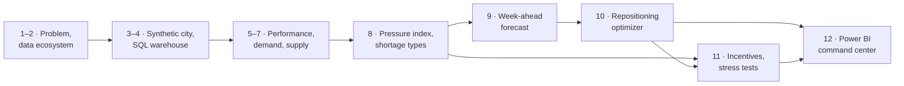

# Phase 1 — 01. Business Problem

> **How should a multi-service marketplace anticipate demand and allocate
> scarce supply across mobility and food delivery to maintain service levels
> and maximize contribution?**

This document states the problem PULSE was built to solve, who has it, which
decisions it drives, and how the project answers it. It was written last, so
each question below links to the phase that answers it and the answer found.

All numbers are model-based estimates on a synthetic Bengaluru, not real-world
impact (see `Assumptions.md`).

---

## 1. The problem in one paragraph

PULSE is a super-app in Bengaluru. One pool of 850 partners serves two kinds of
demand: **rides** (two-wheelers and cabs) and **food delivery** (two-wheelers
only). Demand moves through the city every day: towards offices in the
morning, towards homes and restaurants in the evening, and up sharply on rain
and festival days. Partners start from where they live and drift with the jobs
they take. The result is a marketplace that has **enough partners overall but
not in the right place at the right time**. Customers are turned away in one
zone while partners sit idle a few kilometres away.

---

## 2. Why it matters

| Symptom (16 weeks, whole city) | Value | Why the business cares |
|---|---:|---|
| Jobs requested per day | 9,811 | The demand the platform has already won |
| Ride requests completed | 71.9% | More than 1 ride in 4 fails; food is much better at 93.7% |
| Jobs lost because no partner could arrive in time | 935 per day | Each one is lost revenue and a customer who may not return |
| Partner time spent idle | 52.8% | Partners are paid per job, so idle time is lost earnings and a reason to leave the platform |
| Platform revenue per day | ₹3,37,205 | At ₹40.79 per completed job, the lost jobs are worth about ₹38,000 a day, roughly 11% of revenue |
| Office-zone ride completion, weekday evenings | about 21% | The worst failures cluster in predictable places and hours |

Low completion and high idle time **at the same moment** is the signature of a
*distribution* problem, not a *capacity* problem. That distinction decides
which fix is worth paying for.

---

## 3. Who has the problem

| Stakeholder | What they need from PULSE | Where they look |
|---|---|---|
| **City operations manager** | Where and when will we be short next week, and where should partners be at each hour? | Forecast & Early Warning, Repositioning Flows, Decision Playbook |
| **Marketplace / strategy lead** | Which policy to run: maximise profit or protect service, and at what cost? | Policy Simulator |
| **Finance** | Does each lever pay for itself? What does one more served customer cost? | Policy Simulator, Incentives & Stress Tests |
| **Partner operations** | When are bonuses worth offering, and how much? | Incentives & Stress Tests |
| **Customers and partners** (indirect) | A ride or meal when they ask; steady earnings when online | Completion and idle-time KPIs on every page |

---

## 4. The decisions PULSE supports

| Decision | Cadence | Owner | PULSE answer | Phase |
|---|---|---|---|---|
| Where will demand exceed supply next week? | Weekly | Operations | A week-ahead warning list: flags 29% of zone-hours, which hold 91% of later lost jobs | 9 |
| Which shortages can moving partners fix, and which need more partners? | Weekly | Operations | 72% of lost jobs are *reposition ahead* (spare partners exist nearby in the city); 22% are *citywide* shortages | 8 |
| Should we move idle partners ahead of demand? | Hourly | Operations | Yes: the profit policy cuts lost jobs by 13% at no measurable cost | 10 |
| Profit-first or service-first? | Quarterly | Strategy | Service-first cuts lost jobs by 24% for about ₹17 per extra job; it wins if a completed job is worth more than about ₹19.5 to the business | 10, 12 |
| Should we pay partners to come online? | Per event | Partner ops, finance | Not as a standing programme (₹43–55 per extra job). Only on rain and festival days, below about ₹25 per partner-hour | 11 |
| What should each zone do? | Weekly | Operations | One of five playbook actions per zone, e.g. pre-position at Electronic City, dedicated supply at the airport | 12 |

---

## 5. Working hypotheses, and what the data said

The 12-phase plan was built to test these ideas in order. Writing this last
lets each one be marked against the evidence.

| # | Hypothesis | Verdict | Evidence |
|---|---|---|---|
| H1 | Shortages are caused by *where and when* supply is, more than *how much* supply exists | **Confirmed** | Partners idle 52.8% of their time while 28% of rides fail; office zones hold 47% of partners at 09:00 but 3% at 19:00 (Phase 7) |
| H2 | Demand follows stable, learnable patterns by zone type, hour, day and weather | **Confirmed** | Forecasts beat the seasonal-naive benchmark by 31% (WAPE 25.6%) (Phase 9) |
| H3 | Shortages can be seen a week ahead | **Confirmed** | Warnings cover 29% of zone-hours and 91% of lost jobs; precision 80%, recall 70% (Phase 9) |
| H4 | Moving idle partners ahead of demand recovers lost jobs profitably | **Partly** | It recovers jobs (−13% lost) but the money is a wash (+0.06% contribution, 95% range spanning zero). It is a *service* lever, not a *profit* lever (Phase 10) |
| H5 | Paying partners to come online fixes citywide shortages and pays for itself | **Rejected as a standing policy** | Bonuses recover the most jobs but cost ₹43–55 each; they pay only in stressed situations at low bonus levels (Phase 11) |

H4 is the most important result. On the 5-zone toy model the optimizer gained
+9%. Under realistic Bengaluru economics that gain became service, not profit.
The project reports this honestly instead of tuning until it looked good.

---

## 6. Scope

| In scope | Out of scope (and why) |
|---|---|
| One city (Bengaluru), 24 zones, 1-hour planning periods | Real-time matching of individual jobs: PULSE plans supply, dispatch stays as it is |
| Two services sharing one partner pool, with vehicle eligibility | Pricing and surge fares: demand is taken as given |
| Week-ahead forecasting of demand, supply and shortages | Partner behaviour learned from real data: it is rule-based (Assumptions S-01 to S-05) |
| Hourly repositioning optimization (linear programming, OR-Tools) | Real road routing: a 1.4× detour factor on straight-line distance |
| Incentive economics and stress scenarios | Customer lifetime value: replaced by the "value of one completed job" slider |
| SQL Server warehouse and Power BI command center | Real market data: the city is synthetic, so results are estimates |

---

## 7. How success is judged

A result counts only if it passes these tests:

1. **Fair comparison.** Every policy, including the status quo, is replayed on
   exactly the same customers and orders (common random numbers).
2. **No tuning on the test.** Settings were chosen on validation weeks 9–12;
   the holdout weeks 13–16 were simulated once.
3. **Ranges, not just averages.** Uplifts carry daily 95% ranges; a gain whose
   range spans zero is reported as "no measurable change".
4. **One number, one definition.** Each KPI is defined once
   (`KPI_Dictionary.md`), computed in SQL, and reproduced by Python and by
   Power BI. 30 DAX measures match SQL to two decimals.
5. **Planted truths recovered.** Patterns built into the synthetic city
   (Assumptions §8) were rediscovered by the analysis without being told.

---

## 8. How the project answers the question

| Question | Phase | Folder |
|---|---|---|
| What data does the marketplace produce? | 2 | `02_Data_Ecosystem` |
| How is a realistic city simulated, and stored? | 3–4 | `03_Data_Engineering`, `04_Data_Warehouse` |
| How is the marketplace performing today? | 5 | `05_Marketplace_Analytics` |
| Where and when does demand arrive? | 6 | `06_Demand_Intelligence` |
| Where is supply, and why is it idle? | 7 | `07_Supply_Intelligence` |
| Where is demand above supply, and what kind of shortage is it? | 8 | `08_Supply_Demand_Imbalance` |
| Can shortages be seen a week ahead? | 9 | `09_Forecasting` |
| Does moving partners ahead of demand pay? | 10 | `10_Optimization` |
| When does paying partners pay? | 11 | `11_Incentive_Economics` |
| What should an executive do on Monday? | 12 | `12_PowerBI` |

---

## 9. The answer

1. **Forecast** shortages a week ahead. The warning list is short and it
   catches most of the lost demand.
2. **Run profit repositioning every day.** It serves more customers at no net
   cost.
3. **Switch to service-first repositioning** if a completed job is worth more
   than about ₹20 to the business. That number is a business judgement, so
   PULSE makes it a slider.
4. **Use bonuses only as a surge tool** on rain and festival days, below the
   break-even bonus. Never as a standing programme.
5. **Station dedicated supply** where repositioning cannot help, starting with
   the airport.

Related: `02_Operating_Model.md` (how the marketplace works) ·
`03_Glossary.md` (terms) · `Assumptions.md` · `KPI_Dictionary.md`.
