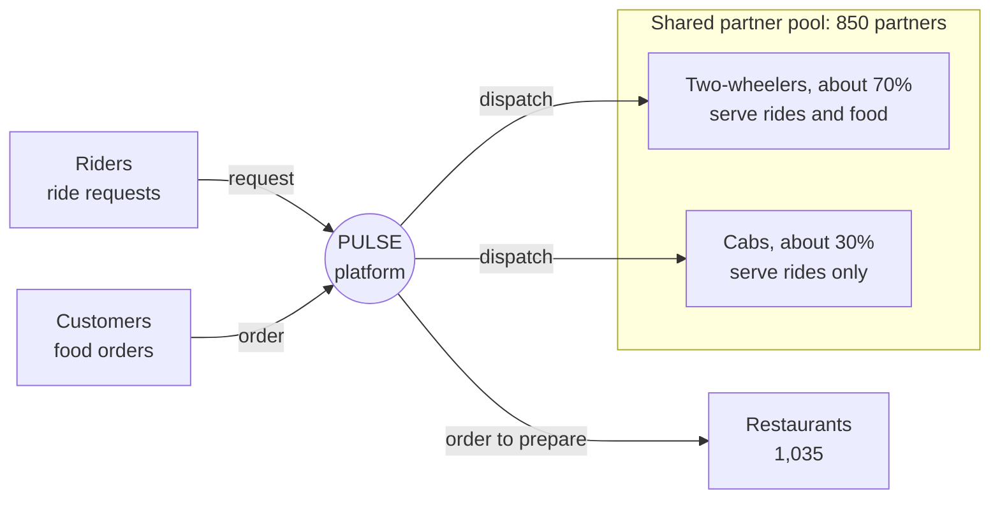
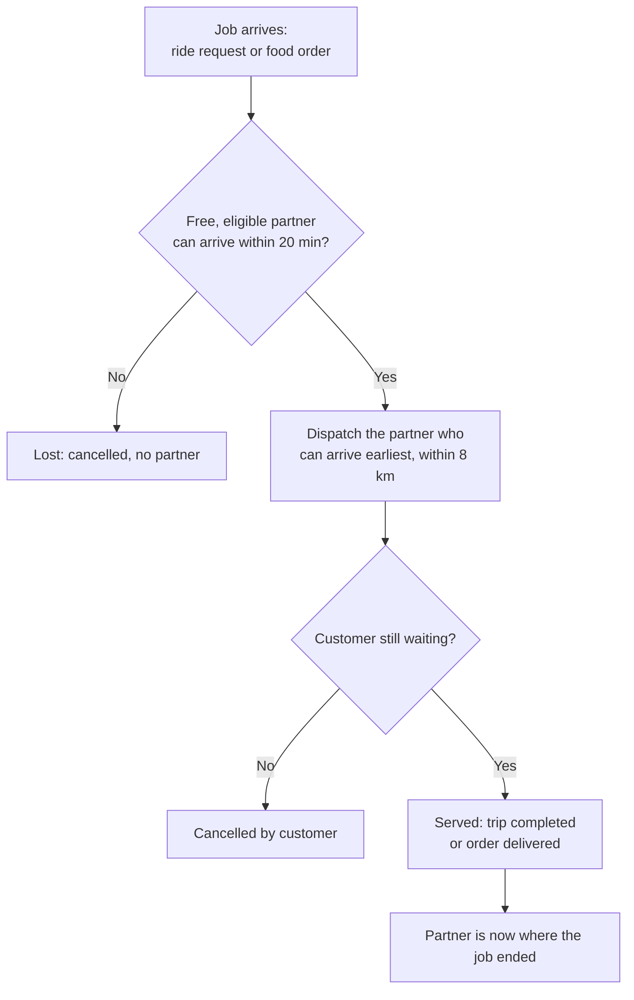
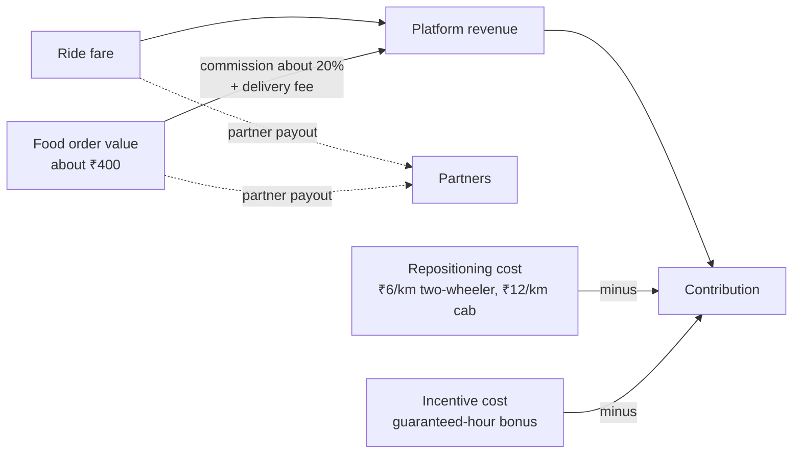
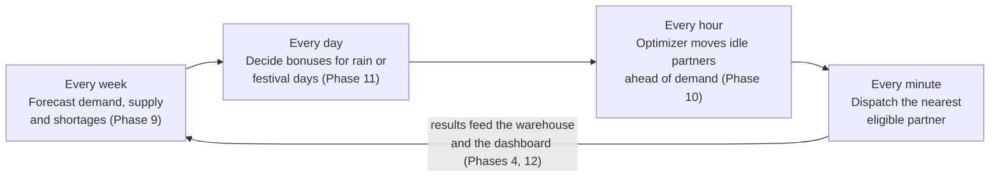

# Phase 1 — 02. Operating Model

How the PULSE marketplace works: who takes part, how a job is served, how
money flows, and which levers the platform controls. The rules behind each
statement are in `Assumptions.md` (IDs in brackets).

---

## 1. One platform, two services, one partner pool

| Actor | Role | Count | Assumptions |
|---|---|---:|---|
| Customers | Request rides and order food; the same person can do both | about 60,000 | C-09 |
| Restaurants | Accept and prepare orders; 3% are rejected | 1,035 | C-08, O-02, O-04 |
| Partners | Serve jobs; one job and one service at a time | 850 | S-01 to S-05 |
| PULSE platform | Matches jobs to partners, moves supply, sets incentives | 1 | M-01 |

### Who can serve what

| Vehicle | Rides | Food delivery | Share of fleet |
|---|:---:|:---:|---:|
| Two-wheeler | ✅ | ✅ | about 70% |
| Cab (four-wheeler) | ✅ | — | about 30% |

This eligibility rule is what makes the problem hard. A two-wheeler serving a
ride at 19:00 is a two-wheeler not delivering dinner (M-02 to M-05).

---

## 2. The city

- **24 zones** built from Bengaluru's BBMP ward boundaries, each with one type
  (C-01 to C-03):

| Zone type | Zones | Demand character (D-03 to D-06) |
|---|---|---|
| Office | Whitefield, Manyata Tech Park, Electronic City, Bellandur–ORR, CBD (MG Road) | Weekday lunch food, evening rides out; quiet weekends |
| Residential | Jayanagar, JP Nagar, Banashankari, Rajajinagar, Malleshwaram, Yelahanka, BTM Layout, Basavanagudi | Morning rides out, dinner food |
| Restaurant cluster | Koramangala, Indiranagar, HSR Layout | Most food; late-night and weekend peaks |
| Mixed | Marathahalli, Hebbal, Sarjapur Road, KR Puram, Yeshwanthpur, Bannerghatta Road | A blend of both |
| Transit hub | Majestic, Kempegowda Airport (KIA) | Ride-heavy, flatter through the day |

- **Travel:** 15 km/h in weekday peaks, 25 km/h otherwise. A partner can be
  moved only within **20 minutes**, so reach shrinks to about 5 km at peak
  (C-04 to C-06).
- **The airport is out of reach** of every other zone; its supply has to be
  there already (C-07).

---

## 3. How a job is served

- **Status-quo dispatch** (what history contains): nearest free eligible
  partner, no moves ahead of demand (O-05).
- **Food** is dispatched just in time to reach the restaurant when the food is
  ready (O-05).
- **Capacity:** one partner-hour completes about 2 rides or 3 deliveries
  (O-01).
- The last step in the chart is why supply drifts: rides carry partners to
  offices in the morning and away from them in the evening (O-07).

Full event lifecycles are in `02_Data_Ecosystem/Data_Ecosystem.md`.

---

## 4. How money flows

| Item | Value | Source |
|---|---|---|
| Platform revenue per completed ride | about ₹27 | Warehouse, history weeks (E-04) |
| Platform revenue per delivered order | about ₹49 | Warehouse, history weeks (E-04) |
| Revenue per completed job, all services | ₹40.79 | Phase 5 / Power BI page 2 |
| Take rate (revenue ÷ gross value) | 13.6% | Phase 5 |
| Repositioning cost | ₹6 per km (two-wheeler), ₹12 per km (cab) | E-06 |
| Incentive | ₹40, ₹60 or ₹80 per guaranteed partner-hour, paid whether or not jobs come | E-07 |

**Contribution** = platform revenue − repositioning cost − incentive cost. It
is the money test for every lever. Economic values are illustrative.

---

## 5. The levers the platform controls

Each lever acts on a different time scale and fixes a different kind of
shortage (Phase 8):

| Lever | Acts | Fixes | Cost | Verdict |
|---|---|---|---|---|
| **Same-hour dispatch** | Minutes | *Fix now* shortages: spare partners already within reach (1% of lost jobs) | None | Already in place |
| **Repositioning ahead of demand** | Hourly, planned by a linear program | *Reposition ahead* shortages: spare partners elsewhere in the city (72%) | ₹6–12 per km driven empty | Profit policy pays for itself; service policy costs about ₹17 per extra job |
| **Incentives** (guaranteed-hour bonus) | Days ahead, per event | *Citywide* shortages: not enough partners online anywhere (22%) | ₹40–80 per partner-hour | Pays only on stressed days at low bonus levels |
| **Policy setting** (profit-first vs service-first) | Quarterly | How much to pay for service | Business judgement | Service-first wins above about ₹19.5 per completed job |

---

## 6. The planning cycle

---

## 7. What the model simplifies

The operating model is deliberately simple where detail would not change the
decision. Partners follow every move instruction, travel uses a detour factor
instead of road routing, and partner behaviour is rule-based. The full list,
with reasons, is in `Assumptions.md` §9–10.

Related: `01_Business_Problem.md` · `03_Glossary.md` · `KPI_Dictionary.md`.
