# Phase 12 — 01. Data Model and Connection

**SQL Script:** `sql/00_create_powerbi_views.sql`

---

## 1. Purpose

Power BI never reads the `dw` tables directly. A dedicated schema, **`pbi`**,
holds one view per Power BI table, so:

- every label, sort order, colour and period is defined **once, in SQL**;
- the model is a clean star: dimensions carry text, facts carry keys and sums;
- **no fact stores a rate**; every rate is a DAX measure
  `SUM(numerator) / SUM(denominator)` (KPI_Dictionary.md rule 4), so a rate is
  correct at any level: zone, zone type, hour, week or the whole city.

---

## 2. Build the views

```bash
python scripts/report_phase12.py
```

This creates the `pbi` views, writes the zone map file and fills the check
tables in `02_DAX_Measures.md`. Run it after `report_phase11.py`; re-running is
safe.

---

## 3. Connect Power BI Desktop

1. **Home → Get data → SQL Server.**
2. Server `localhost`, Database `PULSE_DW`, Data connectivity mode **Import**.
3. If asked about encryption, tick **Trust server certificate** (or choose
   *Use unencrypted connection* for this local server). Sign in with
   **Windows → Use my current credentials**.
4. In the Navigator, expand `pbi` and tick **all 19 views** listed in
   section 5. Click **Load**.
5. **Rename every query to drop the `pbi` prefix**: in the Data pane,
   double-click `pbi Dim_Time` and rename it `Dim_Time`, and so on. The DAX
   file uses the short names.
6. **File → Options → Current file → Data Load**: untick *Autodetect new
   relationships after data is loaded*, then create the relationships in
   section 6 yourself in Model view (or delete any wrong auto-detected ones).

Import of all 19 tables takes under a minute.

---

## 4. Star schema

```mermaid
erDiagram
    Dim_Time ||--o{ Fact_Marketplace : time_key
    Dim_Time ||--o{ Fact_Supply : time_key
    Dim_Time ||--o{ Fact_Pressure : time_key
    Dim_Time ||--o{ Fact_Demand_Forecast : time_key
    Dim_Time ||--o{ Fact_Pressure_Forecast : time_key
    Dim_Time ||--o{ Fact_Policy : time_key
    Dim_Time ||--o{ Fact_Repositioning : time_key
    Dim_Time ||--o{ Fact_Supply_Value : time_key
    Dim_Time ||--o{ Fact_Incentives : time_key
    Dim_Zone ||--o{ Fact_Marketplace : zone_key
    Dim_Zone ||--o{ Fact_Supply : zone_key
    Dim_Zone ||--o{ Fact_Pressure : zone_key
    Dim_Zone ||--o{ Fact_Demand_Forecast : zone_key
    Dim_Zone ||--o{ Fact_Pressure_Forecast : zone_key
    Dim_Zone ||--o{ Fact_Policy : zone_key
    Dim_Zone ||--o{ Fact_Repositioning : origin_zone_key
    Dim_Destination_Zone ||--o{ Fact_Repositioning : dest_zone_key
    Dim_Zone ||--o{ Fact_Supply_Value : zone_key
    Dim_Zone ||--o{ Fact_Incentives : zone_key
    Dim_Service ||--o{ Fact_Marketplace : service_key
    Dim_Service ||--o{ Fact_Demand_Forecast : service_key
    Dim_Service ||--o{ Fact_Policy : service_key
    Dim_Vehicle ||--o{ Fact_Supply : vehicle_key
    Dim_Vehicle ||--o{ Fact_Supply_Value : vehicle_key
    Dim_Forecast_Model ||--o{ Fact_Demand_Forecast : model_name
    Dim_Scenario ||--o{ Fact_Policy : scenario_code
    Dim_Scenario ||--o{ Fact_Repositioning : scenario_code
    Dim_Scenario ||--o{ Fact_Supply_Value : scenario_code
    Dim_Scenario ||--o{ Fact_Incentives : scenario_code
    Dim_Scenario ||--|| Fact_Scenario_Economics : scenario_code
    Stress_Cases ||--o{ Stress_Summary : stress_case
```



---

## 5. Tables

<!-- AUTO:rowcounts -->
| Power BI table | Source view | Grain | Rows | Role |
|---|---|---|---|---|
| Dim_Time | pbi.Dim_Time | Hour (time_key = yyyymmddhh) | 2,712 | Calendar, dayparts, periods, weather |
| Dim_Zone | pbi.Dim_Zone | Zone | 24 | Zone names, types, map key |
| Dim_Destination_Zone | pbi.Dim_Destination_Zone | Zone | 24 | Destination of a repositioning move |
| Dim_Service | pbi.Dim_Service | Service | 2 | Mobility / Food Delivery |
| Dim_Vehicle | pbi.Dim_Vehicle | Vehicle type | 2 | Two-wheeler / cab |
| Dim_Scenario | pbi.Dim_Scenario | Simulated policy | 7 | Names, order, colours, levers |
| Dim_Forecast_Model | pbi.Dim_Forecast_Model | Forecast model | 5 | Names, order, benchmark flag |
| Fact_Marketplace | pbi.Fact_Marketplace | Zone x hour x service | 108,932 | Observed demand, outcomes, money (16 weeks) |
| Fact_Supply | pbi.Fact_Supply | Zone x hour x vehicle | 102,797 | Partner-hours: online, busy, idle; empty km |
| Fact_Pressure | pbi.Fact_Pressure | Zone x hour | 64,512 | Pressure index inputs, states, shortage types |
| Fact_Demand_Forecast | pbi.Fact_Demand_Forecast | Zone x hour x service x model | 161,280 | Holdout forecasts vs actual |
| Fact_Pressure_Forecast | pbi.Fact_Pressure_Forecast | Zone x hour | 16,128 | Week-ahead shortage warnings vs outcome |
| Fact_Policy | pbi.Fact_Policy | Scenario x zone x hour x service | 190,659 | Simulated outcomes per policy |
| Fact_Repositioning | pbi.Fact_Repositioning | Scenario x hour x corridor | 3,530 | Optimizer moves |
| Fact_Supply_Value | pbi.Fact_Supply_Value | Scenario x zone x hour x vehicle | 44,868 | Value of one more partner (shadow price) |
| Fact_Incentives | pbi.Fact_Incentives | Scenario x zone x hour | 7,420 | Bonus partner-hours and cost |
| Fact_Scenario_Economics | pbi.Fact_Scenario_Economics | Scenario | 7 | Revenue, costs, contribution (whole holdout) |
| Stress_Summary | pbi.Stress_Summary | Stress case x policy | 20 | Stress-test outcomes |
| Stress_Cases | pbi.Stress_Cases | Stress case | 5 | Inputs for the bonus what-if |

_Generated 2026-10-18 by a report script — do not edit by hand._
<!-- /AUTO:rowcounts -->

Three families of facts, three time windows. Each page's notes say which it uses.

| Family | Tables | Window |
|---|---|---|
| Observed marketplace | `Fact_Marketplace`, `Fact_Supply`, `Fact_Pressure` | All 16 weeks (slice with `Dim_Time[period]`) |
| Forecasts | `Fact_Demand_Forecast`, `Fact_Pressure_Forecast` | Holdout weeks 13–16 |
| Simulated policies | `Fact_Policy`, `Fact_Repositioning`, `Fact_Supply_Value`, `Fact_Incentives`, `Fact_Scenario_Economics` | Holdout weeks 13–16, replayed with the same customers |
| Stress tests | `Stress_Summary`, `Stress_Cases` | 14 holdout days per stress case |

The status quo appears twice on purpose: `Fact_Marketplace` is what happened in
the generated history; `Fact_Policy` with scenario *Status quo* is the replay
of the holdout weeks that every other policy is compared with (Phase 10). Never
compare a policy with `Fact_Marketplace`.

---

## 6. Relationships

All single direction, many-to-one, from fact to dimension, **except** the
one-to-one `Dim_Scenario`–`Fact_Scenario_Economics` (Power BI sets it to both
directions automatically; that is fine because the rows match one to one).

| From (many) | To (one) | Active |
|---|---|---|
| every fact `[time_key]` | `Dim_Time[time_key]` | ✅ |
| every fact `[zone_key]` | `Dim_Zone[zone_key]` | ✅ |
| `Fact_Repositioning[origin_zone_key]` | `Dim_Zone[zone_key]` | ✅ |
| `Fact_Repositioning[dest_zone_key]` | `Dim_Destination_Zone[dest_zone_key]` | ✅ |
| `Fact_Marketplace`, `Fact_Demand_Forecast`, `Fact_Policy` `[service_key]` | `Dim_Service[service_key]` | ✅ |
| `Fact_Supply`, `Fact_Supply_Value` `[vehicle_key]` | `Dim_Vehicle[vehicle_key]` | ✅ |
| `Fact_Demand_Forecast[model_name]` | `Dim_Forecast_Model[model_name]` | ✅ |
| `Fact_Policy`, `Fact_Repositioning`, `Fact_Supply_Value`, `Fact_Incentives` `[scenario_code]` | `Dim_Scenario[scenario_code]` | ✅ |
| `Fact_Scenario_Economics[scenario_code]` | `Dim_Scenario[scenario_code]` | ✅ (1:1) |
| `Stress_Summary[stress_case]` | `Stress_Cases[stress_case]` | ✅ |

`Dim_Destination_Zone` is a **role-playing** copy of the zone dimension: a
repositioning move has two zones, and one table cannot filter both. Using a
second table (not an inactive relationship) lets one visual show origin and
destination side by side, which the flow map needs.

---

## 7. Model settings (Model view)

| Setting | Where | Why |
|---|---|---|
| Sort `hour_label` by `hour_of_day`; `daypart` by `daypart_sort`; `period` by `period_sort`; `day_short`/`day_name` by `day_of_week` | `Dim_Time` | Hours and days in clock order |
| Sort `zone_type` by `zone_type_sort` | `Dim_Zone` | Office → transit hub → restaurant → mixed → residential |
| Sort `scenario_name`, `scenario_short` by `scenario_sort` | `Dim_Scenario` | Status quo first, then levers by cost |
| Sort `model_name` by `model_sort` | `Dim_Forecast_Model` | Benchmark first |
| Sort `pressure_state` by `pressure_state_sort`; `shortage_type` by `shortage_type_sort`; `outcome` by `outcome_sort` | facts | Logical order in legends |
| Sort `stress_label` by `stress_sort`; `policy_label` by `policy_sort` | `Stress_*` | Normal day first |
| Data category **Latitude / Longitude** | `Dim_Zone`, `Dim_Destination_Zone` | Flow map and Azure Maps |
| Hide every `*_key`, `*_sort` and `colour` column | all tables | Report authors see only fields meant for visuals |
| Mark `Dim_Time` **not** as a date table | — | It is hour-grain; no time intelligence is needed |
| Summarization **Don't summarize** on `hour_of_day`, `week_number`, `bonus`, `latitude`, `longitude` | dimensions | Stops Power BI from summing them |

Create the empty measures table: **Home → Enter data**, name it `_Measures`,
load it, then (after the measures exist) delete its placeholder column. It
jumps to the top of the Data pane with a calculator icon.

---

## 8. Tables created in Power BI (not in SQL)

| Table | How | Used by |
|---|---|---|
| `_Measures` | Home → Enter data (empty) | Holds all measures |
| `Job Value` | Modeling → New parameter → **Numeric range**: name `Job Value`, min 0, max 100, increment 1, default 20, *Add slicer* on | Policy Simulator what-if |
| `Bonus` | Numeric range: name `Bonus`, min 0, max 100, increment 1, default 60 | Incentives what-if |
| `Map Metric` | Modeling → New table, formula below | Metric switch for the maps |

```dax
Map Metric =
DATATABLE (
    "Metric", STRING, "Order", INTEGER,
    {
        { "Jobs lost per day", 1 },
        { "Demand per day", 2 },
        { "Completion %", 3 },
        { "Partners idle %", 4 },
        { "Pressure index (MPI)", 5 },
        { "Value of one more partner-hour", 6 }
    }
)
```

Sort `Map Metric[Metric]` by `Map Metric[Order]`. None of these three tables
has a relationship: they are **disconnected** tables read by measures through
`SELECTEDVALUE`, the standard way to drive what-if inputs.

---

## 9. Reproducibility

`sql/00_create_powerbi_views.sql` is the single source of the model's shape;
`scripts/report_phase12.py` rebuilds it and the row counts above.
