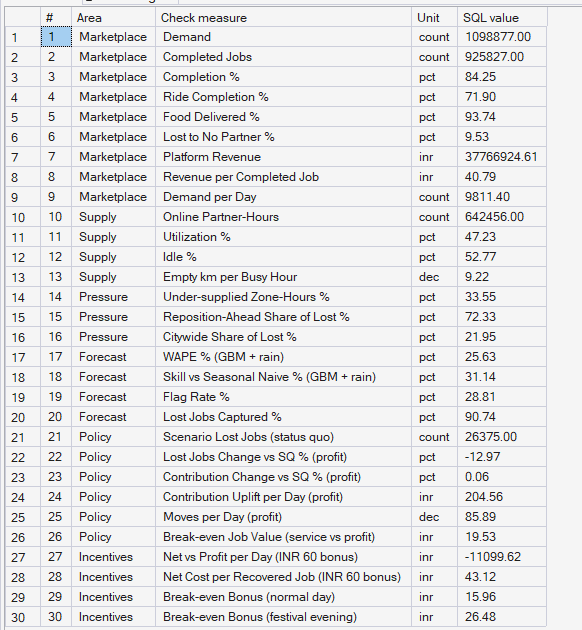
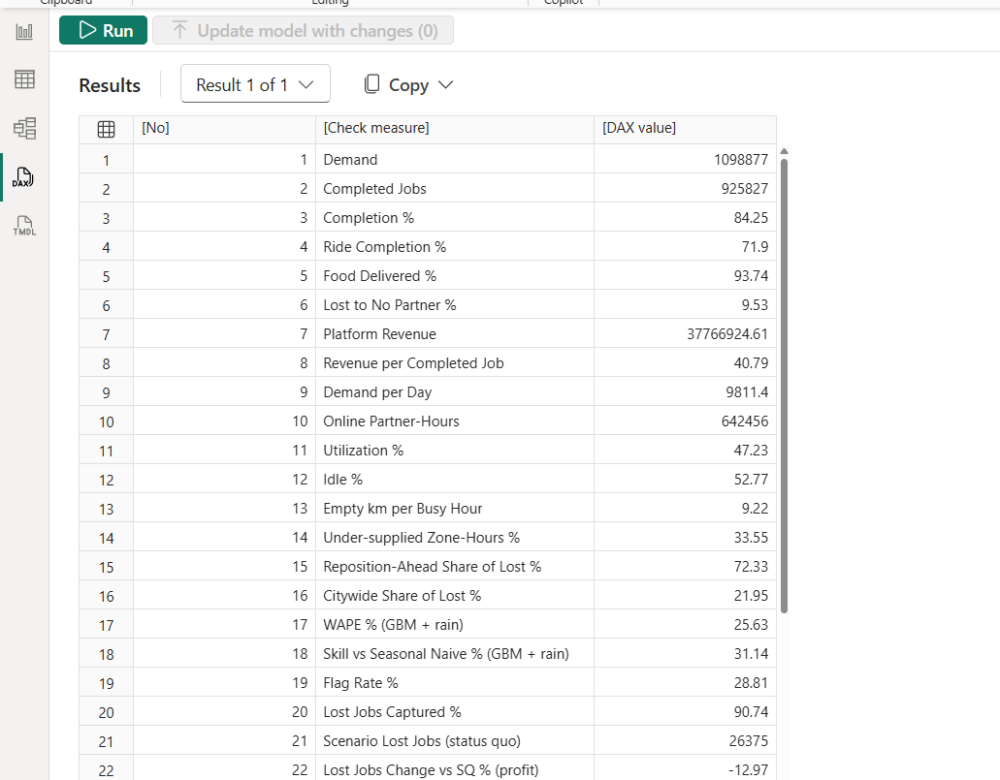
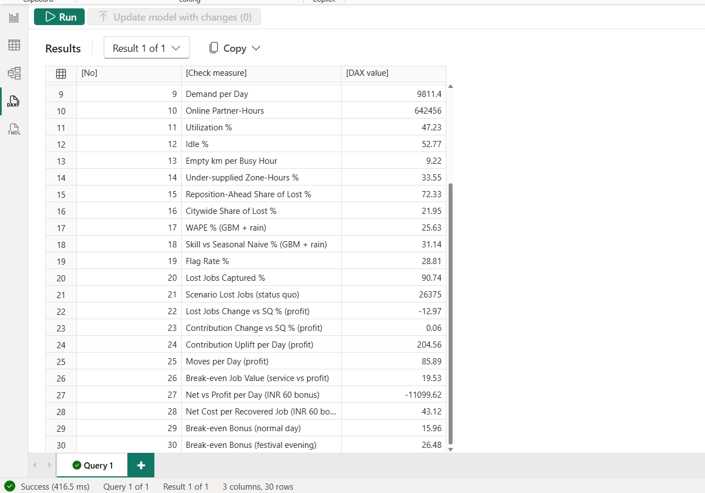
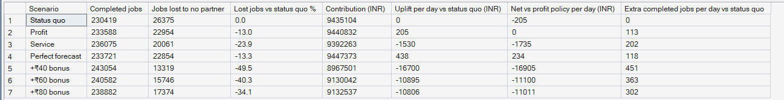

# Phase 12 — 02. DAX Measures and Validation

**SQL Script:** `sql/01_dashboard_checks.sql` · **DAX:** `dax/PULSE_measures.dax`

---

## 1. Business Question

Can an executive trust every number on the dashboard? In other words, does each
DAX measure give exactly the result the SQL warehouse and the Phase 5–11
documents give?

---

## 2. Objective

Define every measure once, in one file, then prove 30 of them against SQL. The
30 cover every page and every type of calculation: sums, ratios of sums,
per-day rates, comparisons against a baseline scenario, and the what-if inputs.

---

## 3. Data Sources

- The 19 `pbi` views (`01_Data_Model.md`)
- The checks query `sql/01_dashboard_checks.sql`, which computes the same 30
  numbers in SQL directly from the views

---

## 4. Analytical Grain

Each check is a single number for the whole city and the window that measure
uses: 16 weeks for observed KPIs, holdout weeks 13–16 for forecasts and
policies, 14 holdout days for stress tests.

---

## 5. Techniques Used

- **Ratio of sums**: e.g. `Completion % = DIVIDE([Completed Jobs], [Demand])`,
  never an average of stored rates
- **Baseline comparison**: `CALCULATE(..., REMOVEFILTERS(Dim_Scenario),
  Dim_Scenario[scenario_code] = "status_quo")`. `REMOVEFILTERS` is needed
  because a visual grouped by `scenario_name` also filters the hidden sort
  column; without it the baseline would be blank
- **Role-playing dimension** with `TREATAS`: partners moved *into* a zone
- **Disconnected what-if tables** read with `SELECTEDVALUE` (job value, bonus,
  map metric)
- **Context transition** inside `ADDCOLUMNS` / `FILTER` (best lever at a given
  job value; stress cases where a bonus pays)
- **Dynamic text measures** for headlines that change with slicers
- **DAX query view**: the measures and their checks in one runnable query

---

## 6. Adding all the measures in one step

1. Build the model and the three Power BI tables (`01_Data_Model.md`, sections 3 and 8).
2. **DAX query view** (left rail, fourth icon) → **New query**. Paste the whole
   of `dax/PULSE_measures.dax`.
3. Click **Update model with changes**. All measures are created in
   `_Measures`.
4. Press **Run (F5)**. The result grid lists the 30 checks; each **DAX value**
   must equal **SQL value** in Result Set A below.
5. Set each measure's format string from the catalogue (Measure tools →
   Format), and its display folder (Model view → Properties → Display
   folder). Tip: in Model view, Ctrl+click every measure of one folder and set
   the folder for all of them at once.

---

## 7. Result Set A — Numbers the Dashboard Must Reproduce

<!-- AUTO:A -->
| # | Area | Check measure | SQL value | Power BI shows |
|---|---|---|---|---|
| 1 | Marketplace | Demand | 1,098,877.00 | 1,098,877 |
| 2 | Marketplace | Completed Jobs | 925,827.00 | 925,827 |
| 3 | Marketplace | Completion % | 84.25 | 84.2% |
| 4 | Marketplace | Ride Completion % | 71.90 | 71.9% |
| 5 | Marketplace | Food Delivered % | 93.74 | 93.7% |
| 6 | Marketplace | Lost to No Partner % | 9.53 | 9.5% |
| 7 | Marketplace | Platform Revenue | 37,766,924.61 | ₹37,766,925 |
| 8 | Marketplace | Revenue per Completed Job | 40.79 | ₹40.79 |
| 9 | Marketplace | Demand per Day | 9,811.40 | 9,811 |
| 10 | Supply | Online Partner-Hours | 642,456.00 | 642,456 |
| 11 | Supply | Utilization % | 47.23 | 47.2% |
| 12 | Supply | Idle % | 52.77 | 52.8% |
| 13 | Supply | Empty km per Busy Hour | 9.22 | 9.2 |
| 14 | Pressure | Under-supplied Zone-Hours % | 33.55 | 33.5% |
| 15 | Pressure | Reposition-Ahead Share of Lost % | 72.33 | 72.3% |
| 16 | Pressure | Citywide Share of Lost % | 21.95 | 21.9% |
| 17 | Forecast | WAPE % (GBM + rain) | 25.63 | 25.6% |
| 18 | Forecast | Skill vs Seasonal Naive % (GBM + rain) | 31.14 | 31.1% |
| 19 | Forecast | Flag Rate % | 28.81 | 28.8% |
| 20 | Forecast | Lost Jobs Captured % | 90.74 | 90.7% |
| 21 | Policy | Scenario Lost Jobs (status quo) | 26,375.00 | 26,375 |
| 22 | Policy | Lost Jobs Change vs SQ % (profit) | -12.97 | -13.0% |
| 23 | Policy | Contribution Change vs SQ % (profit) | 0.06 | 0.1% |
| 24 | Policy | Contribution Uplift per Day (profit) | 204.56 | ₹205 |
| 25 | Policy | Moves per Day (profit) | 85.89 | 85.9 |
| 26 | Policy | Break-even Job Value (service vs profit) | 19.53 | ₹19.53 |
| 27 | Incentives | Net vs Profit per Day (INR 60 bonus) | -11,099.62 | −₹11,100 |
| 28 | Incentives | Net Cost per Recovered Job (INR 60 bonus) | 43.12 | ₹43.12 |
| 29 | Incentives | Break-even Bonus (normal day) | 15.96 | ₹15.96 |
| 30 | Incentives | Break-even Bonus (festival evening) | 26.48 | ₹26.48 |

_Generated 2026-10-18 by a report script — do not edit by hand._
<!-- /AUTO:A -->

### SQL screenshot

### DAX screenshot

The same 30 rows from DAX query view (step 6.4):

---

## 8. Result Set B — Scenario Economics in the Power BI Layer

Reconciles `pbi.Fact_Scenario_Economics` to Phase 10 (`10_Optimization/02_Policy_Comparison.md`)
and Phase 11 (`11_Incentive_Economics/02_Incentive_Results.md`).

<!-- AUTO:B -->
| Scenario | Completed jobs | Jobs lost to no partner | Lost jobs vs status quo % | Contribution (INR) | Uplift per day vs status quo (INR) | Net vs profit policy per day (INR) | Extra completed jobs per day vs status quo |
|---|---|---|---|---|---|---|---|
| Status quo | 230,419 | 26,375 | 0.0 | ₹9,435,104 | ₹0 | −₹205 | 0 |
| Profit | 233,588 | 22,954 | -13.0 | ₹9,440,832 | ₹205 | ₹0 | 113 |
| Service | 236,075 | 20,061 | -23.9 | ₹9,392,263 | −₹1,530 | −₹1,735 | 202 |
| Perfect forecast | 233,721 | 22,854 | -13.3 | ₹9,447,373 | ₹438 | ₹234 | 118 |
| +₹40 bonus | 243,054 | 13,319 | -49.5 | ₹8,967,501 | −₹16,700 | −₹16,905 | 451 |
| +₹60 bonus | 240,582 | 15,746 | -40.3 | ₹9,130,042 | −₹10,895 | −₹11,100 | 363 |
| +₹80 bonus | 238,882 | 17,374 | -34.1 | ₹9,132,537 | −₹10,806 | −₹11,011 | 302 |

_Generated 2026-10-18 by a report script — do not edit by hand._
<!-- /AUTO:B -->

### Screenshot

---

## 9. Key Observations

### 9.1 One definition per number
Every rate on the dashboard is a measure over sums, so a zone, an hour or the
whole city all use the same formula; the SQL checks confirm the city totals.

### 9.2 Two definitions of a "job won back"
Phase 11's ladder counts jobs **no longer lost to no partner** (service policy:
about ₹17 per job). The Policy Simulator counts **extra completed jobs**, which
also nets out the extra customer cancellations of longer pickups (service
policy: about ₹20 per job, the Phase 10 figure). Both are shown, each labelled.

### 9.3 Incentive scenarios carry their own costs
Phase 11 did not store individual moves for the incentive scenarios, so their
repositioning cost comes from `Agg_Scenario_Summary`. That is why the
economics table is one row per scenario and is not sliced by zone or hour.

---

## 10. Measure Catalogue

Generated from `dax/PULSE_measures.dax`; the format string is what to set in
Measure tools → Format.

<!-- AUTO:catalogue -->
| Display folder | Measure | Format string |
|---|---|---|
| 00 Calendar | Days | #,0 |
| 00 Calendar | Hours | #,0 |
| 00 Calendar | Holdout Days | #,0 |
| 00 Calendar | Holdout Weekdays | #,0 |
| 01 Marketplace (Phase 5) | Demand | #,0 |
| 01 Marketplace (Phase 5) | Completed Jobs | #,0 |
| 01 Marketplace (Phase 5) | Lost Jobs | #,0 |
| 01 Marketplace (Phase 5) | Customer Cancels | #,0 |
| 01 Marketplace (Phase 5) | Completion % | 0.0% |
| 01 Marketplace (Phase 5) | Lost to No Partner % | 0.0% |
| 01 Marketplace (Phase 5) | Customer Cancel % | 0.0% |
| 01 Marketplace (Phase 5) | Platform Revenue | ₹#,0 |
| 01 Marketplace (Phase 5) | Gross Value | ₹#,0 |
| 01 Marketplace (Phase 5) | Partner Payout | ₹#,0 |
| 01 Marketplace (Phase 5) | Take Rate % | 0.0% |
| 01 Marketplace (Phase 5) | Revenue per Completed Job | ₹#,0.00 |
| 01 Marketplace (Phase 5) | Demand per Day | #,0 |
| 01 Marketplace (Phase 5) | Completed per Day | #,0 |
| 01 Marketplace (Phase 5) | Lost Jobs per Day | #,0 |
| 01 Marketplace (Phase 5) | Revenue per Day | ₹#,0 |
| 01 Marketplace (Phase 5) | Ride Completion % | 0.0% |
| 01 Marketplace (Phase 5) | Food Delivered % | 0.0% |
| 01 Marketplace (Phase 5) | Rides Lost to No Partner % | 0.0% |
| 01 Marketplace (Phase 5) | Avg Pickup ETA (min) | 0.0 |
| 01 Marketplace (Phase 5) | Avg Order-to-Door (min) | 0.0 |
| 01 Marketplace (Phase 5) | Rain Demand Uplift % | 0.0% |
| 02 Supply (Phase 7) | Online Partner-Hours | #,0 |
| 02 Supply (Phase 7) | Avg Partners Online | #,0.0 |
| 02 Supply (Phase 7) | Utilization % | 0.0% |
| 02 Supply (Phase 7) | Idle % | 0.0% |
| 02 Supply (Phase 7) | Idle Partner-Hours per Day | #,0 |
| 02 Supply (Phase 7) | Empty km per Busy Hour | 0.0 |
| 02 Supply (Phase 7) | Share of City Supply % | 0.0% |
| 03 Pressure (Phase 8) | Work Hours | #,0 |
| 03 Pressure (Phase 8) | Supply Hours | #,0 |
| 03 Pressure (Phase 8) | MPI | 0.00 |
| 03 Pressure (Phase 8) | Neighbourhood MPI | 0.00 |
| 03 Pressure (Phase 8) | City MPI | 0.00 |
| 03 Pressure (Phase 8) | Zone-Hours | #,0 |
| 03 Pressure (Phase 8) | Under-supplied Zone-Hours | #,0 |
| 03 Pressure (Phase 8) | Under-supplied Zone-Hours % | 0.0% |
| 03 Pressure (Phase 8) | Pressure Lost Jobs | #,0 |
| 03 Pressure (Phase 8) | Pressure Lost Jobs per Day | #,0 |
| 03 Pressure (Phase 8) | Share of Lost Jobs % | 0.0% |
| 03 Pressure (Phase 8) | Reposition-Ahead Share of Lost % | 0.0% |
| 03 Pressure (Phase 8) | Citywide Share of Lost % | 0.0% |
| 03 Pressure (Phase 8) | Pressure State | Text |
| 03 Pressure (Phase 8) | Pressure Colour | Text |
| 04 Forecast (Phase 9, holdout) | Forecast Demand | #,0 |
| 04 Forecast (Phase 9, holdout) | Actual Demand | #,0 |
| 04 Forecast (Phase 9, holdout) | WAPE % | 0.0% |
| 04 Forecast (Phase 9, holdout) | Forecast Bias % | 0.0% |
| 04 Forecast (Phase 9, holdout) | Skill vs Seasonal Naive % | 0.0% |
| 04 Forecast (Phase 9, holdout) | Flagged Zone-Hours | #,0 |
| 04 Forecast (Phase 9, holdout) | Short Zone-Hours | #,0 |
| 04 Forecast (Phase 9, holdout) | Correct Warnings | #,0 |
| 04 Forecast (Phase 9, holdout) | Flag Rate % | 0.0% |
| 04 Forecast (Phase 9, holdout) | Precision % | 0.0% |
| 04 Forecast (Phase 9, holdout) | Recall % | 0.0% |
| 04 Forecast (Phase 9, holdout) | Lost Jobs Captured % | 0.0% |
| 04 Forecast (Phase 9, holdout) | Warning Zone-Hours | #,0 |
| 04 Forecast (Phase 9, holdout) | Warning Lost Jobs | #,0 |
| 04 Forecast (Phase 9, holdout) | Share of Warning Lost Jobs % | 0.0% |
| 05 Policy outcomes (Phases 10-11, zone x hour) | Scenario Requests | #,0 |
| 05 Policy outcomes (Phases 10-11, zone x hour) | Scenario Completed | #,0 |
| 05 Policy outcomes (Phases 10-11, zone x hour) | Scenario Lost Jobs | #,0 |
| 05 Policy outcomes (Phases 10-11, zone x hour) | Scenario Revenue | ₹#,0 |
| 05 Policy outcomes (Phases 10-11, zone x hour) | Scenario Completion % | 0.0% |
| 05 Policy outcomes (Phases 10-11, zone x hour) | Scenario Ride Completion % | 0.0% |
| 05 Policy outcomes (Phases 10-11, zone x hour) | Scenario Food Delivered % | 0.0% |
| 05 Policy outcomes (Phases 10-11, zone x hour) | Scenario Lost Jobs per Day | #,0 |
| 05 Policy outcomes (Phases 10-11, zone x hour) | Status Quo Lost Jobs | #,0 |
| 05 Policy outcomes (Phases 10-11, zone x hour) | Status Quo Completed | #,0 |
| 05 Policy outcomes (Phases 10-11, zone x hour) | Lost Jobs vs Status Quo % | 0.0% |
| 05 Policy outcomes (Phases 10-11, zone x hour) | Jobs Recovered % | 0.0% |
| 05 Policy outcomes (Phases 10-11, zone x hour) | Extra Completed Jobs per Day | #,0 |
| 05 Policy outcomes (Phases 10-11, zone x hour) | Revenue Gain vs Profit Policy | ₹#,0 |
| 06 Repositioning and value of supply (Phase 10) | Moves | #,0 |
| 06 Repositioning and value of supply (Phase 10) | Moves per Day | #,0.0 |
| 06 Repositioning and value of supply (Phase 10) | Move Cost | ₹#,0 |
| 06 Repositioning and value of supply (Phase 10) | Move Cost per Day | ₹#,0 |
| 06 Repositioning and value of supply (Phase 10) | Avg Move km | 0.0 |
| 06 Repositioning and value of supply (Phase 10) | Avg Move (min) | 0.0 |
| 06 Repositioning and value of supply (Phase 10) | Moves In | #,0 |
| 06 Repositioning and value of supply (Phase 10) | Net Partners Moved In per Day | #,0 |
| 06 Repositioning and value of supply (Phase 10) | Value of One More Partner-Hour | ₹#,0 |
| 06 Repositioning and value of supply (Phase 10) | Value of One More Two-Wheeler | ₹#,0 |
| 07 Incentive programmes by zone (Phase 11) | Incentive Cost | ₹#,0 |
| 07 Incentive programmes by zone (Phase 11) | Incentive Partner-Hours | #,0 |
| 07 Incentive programmes by zone (Phase 11) | Incentive Partner-Hours per Day | #,0 |
| 07 Incentive programmes by zone (Phase 11) | Incentive Cost per Day | ₹#,0 |
| 07 Incentive programmes by zone (Phase 11) | Revenue per Rupee of Incentive | 0.00 |
| 07 Incentive programmes by zone (Phase 11) | Revenue Gain vs Profit per Day | ₹#,0 |
| 08 Scenario economics (whole holdout) | Scenario Days | #,0 |
| 08 Scenario economics (whole holdout) | Contribution | ₹#,0 |
| 08 Scenario economics (whole holdout) | Contribution per Day | ₹#,0 |
| 08 Scenario economics (whole holdout) | Econ Revenue | ₹#,0 |
| 08 Scenario economics (whole holdout) | Econ Repositioning Cost | ₹#,0 |
| 08 Scenario economics (whole holdout) | Econ Incentive Cost | ₹#,0 |
| 08 Scenario economics (whole holdout) | Econ Completed | #,0 |
| 08 Scenario economics (whole holdout) | Econ Lost Jobs | #,0 |
| 08 Scenario economics (whole holdout) | Econ Moves per Day | #,0.0 |
| 08 Scenario economics (whole holdout) | SQ Contribution | ₹#,0 |
| 08 Scenario economics (whole holdout) | SQ Econ Completed | #,0 |
| 08 Scenario economics (whole holdout) | SQ Econ Lost Jobs | #,0 |
| 08 Scenario economics (whole holdout) | Profit Contribution | ₹#,0 |
| 08 Scenario economics (whole holdout) | Profit Econ Completed | #,0 |
| 08 Scenario economics (whole holdout) | Profit Econ Lost Jobs | #,0 |
| 08 Scenario economics (whole holdout) | Contribution Change vs SQ % | 0.0% |
| 08 Scenario economics (whole holdout) | Contribution Uplift per Day | ₹#,0 |
| 08 Scenario economics (whole holdout) | Econ Lost Jobs vs SQ % | 0.0% |
| 08 Scenario economics (whole holdout) | Econ Extra Completed per Day | #,0 |
| 08 Scenario economics (whole holdout) | Net vs Profit per Day | ₹#,0 |
| 08 Scenario economics (whole holdout) | Jobs Recovered per Day vs Profit | #,0 |
| 08 Scenario economics (whole holdout) | Net Cost per Recovered Job | ₹#,0.0 |
| 08 Scenario economics (whole holdout) | Break-even Job Value | ₹#,0.0 |
| 09 What-if: value of a completed job | Selected Job Value | ₹#,0 |
| 09 What-if: value of a completed job | Value-Adjusted Gain per Day | ₹#,0 |
| 09 What-if: value of a completed job | Best Lever at Job Value | Text |
| 09 What-if: value of a completed job | Best Lever Gain per Day | ₹#,0 |
| 09 What-if: value of a completed job | Actionable Gain per Day | ₹#,0 |
| 09 What-if: value of a completed job | Gain per day vs status quo | ₹#,0 |
| 09 What-if: value of a completed job | Best Lever Title | Text |
| 10 Stress tests and the bonus what-if | Selected Bonus | ₹#,0 |
| 10 Stress tests and the bonus what-if | Stress Completion % | 0.0% |
| 10 Stress tests and the bonus what-if | Stress Lost per Day | #,0 |
| 10 Stress tests and the bonus what-if | Stress Contribution per Day | ₹#,0 |
| 10 Stress tests and the bonus what-if | Lost vs Normal Status Quo % | 0.0% |
| 10 Stress tests and the bonus what-if | Recovered by Profit % | 0.0% |
| 10 Stress tests and the bonus what-if | Recovered by Service % | 0.0% |
| 10 Stress tests and the bonus what-if | Extra Jobs per Day from Incentive | #,0 |
| 10 Stress tests and the bonus what-if | Break-even Bonus | ₹#,0.0 |
| 10 Stress tests and the bonus what-if | Incentive Net per Day at Bonus | #,0 |
| 10 Stress tests and the bonus what-if | Stress Cases Paying at Bonus | 0 |
| 10 Stress tests and the bonus what-if | Bonus Pays Colour | Text |
| 11 Map metric switch | Map Value | Dynamic (see 04_Interactivity.md) |
| 11 Map metric switch | Map Title | Text |
| 12 Narrative and playbook | Headline Problem | Text |
| 12 Narrative and playbook | Headline Forecast | Text |
| 12 Narrative and playbook | Headline Optimizer | Text |
| 12 Narrative and playbook | Headline Incentives | Text |
| 12 Narrative and playbook | Zone Headline | Text |
| 12 Narrative and playbook | Zone Playbook | Text |
| 12 Narrative and playbook | Playbook Colour | Text |
| 12 Narrative and playbook | Scenario Colour | Text |
| 12 Narrative and playbook | Ladder Profit Uplift per Day | ₹#,0 |
| 12 Narrative and playbook | Ladder Service Cost per Job | ₹#,0.0 |
| 12 Narrative and playbook | Ladder Bonus Cost per Job | ₹#,0.0 |
<!-- /AUTO:catalogue -->

---

## 11. Scope Control

Measures read only the `pbi` views. Nothing is re-estimated in Power BI: all
forecasts, simulations and shadow prices come from Phases 9–11.

---

## 12. Reproducibility

`dax/PULSE_measures.dax` creates every measure; `sql/01_dashboard_checks.sql`
recomputes the 30 checks; `scripts/report_phase12.py` regenerates the tables in
this document.

---

## Conclusion

<!-- AUTO:headline -->
- The Power BI layer reproduces the warehouse: **1,098,877** jobs, ride completion **71.9%**, food **93.7%**, partners idle **52.8%** of online time.
- Policy results match Phases 10–11: profit repositioning changes lost jobs by **-13.0%** and contribution by **+0.06%**; a completed job must be worth more than **₹19.5** for the service policy to win.
- The fewest lost jobs come from **+₹40 bonus** (13,319 lost), at −₹16,905 a day against the profit policy.
- Incentive break-even rises from **₹16.0** per partner-hour on a normal day to **₹26.5** on festival evenings.

_Generated 2026-10-18 by a report script — do not edit by hand._
<!-- /AUTO:headline -->
