# Phase 12 — Executive Marketplace Command Center (Power BI)

An interactive Power BI report that turns Phases 5–11 into one decision tool:
what is going wrong in the Bengaluru marketplace, where, whether it can be seen
coming, and which lever (repositioning, service setting or bonuses) to pull, at
what price.

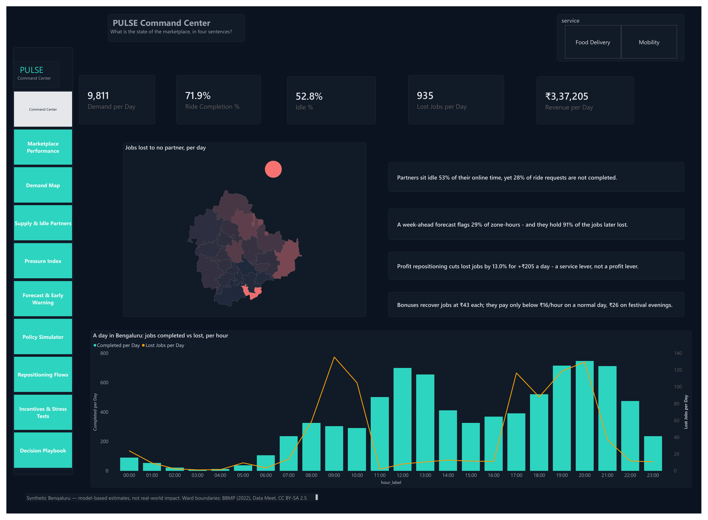

## What makes it interactive

| Feature | What the viewer does |
|---|---|
| **Real Bengaluru map** | Hover or click any of the 24 zones (built from BBMP ward boundaries) |
| **Map metric switch** | One map shows demand, lost jobs, completion, idle partners, pressure or the value of a partner |
| **Policy what-if** | Slide "what is a completed job worth?"; the best policy and the crossing points update |
| **Bonus what-if** | Slide the bonus per partner-hour; see in which situations a bonus pays |
| **Play axis** | Press play to watch partners and lost jobs move through the day |
| **Drillthrough** | Right-click any zone → a full page about that zone |
| **Rich tooltips** | Hover a zone → lost jobs, completion, pressure index and its playbook action |
| **AI visual** | Decomposition tree: click + to find where lost jobs come from |
| **Page navigator + Reset buttons** | One-click navigation; sliders snap back to their defaults |
| **Dynamic headlines** | Sentences on page 1 and the zone page are measures, so they follow the filters |
| **Data-driven colours** | Bars turn green when a bonus pays; every zone's action is colour-coded |

## Pages

| # | Page | Screenshot |
|---|---|---|
| 1 | Command Center |  |
| 2 | Marketplace Performance | 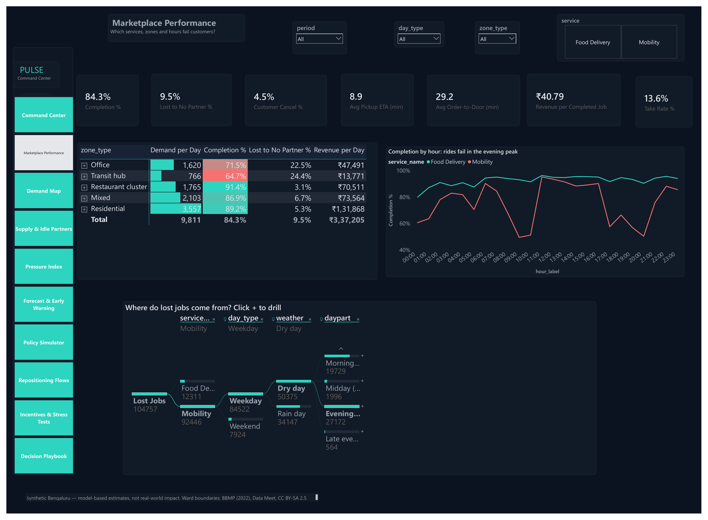 |
| 3 | Demand Map | 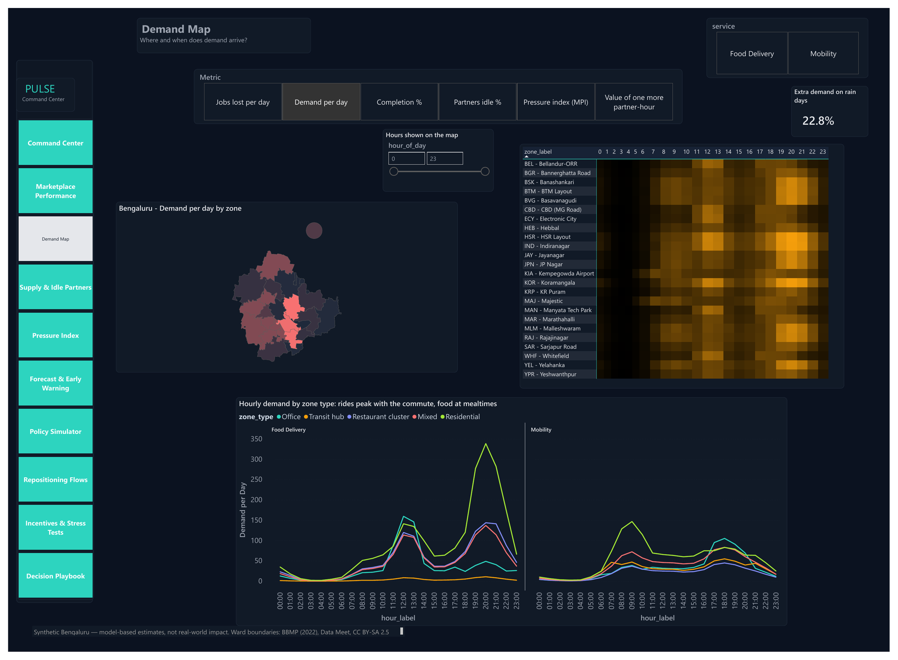 |
| 4 | Supply & Idle Partners | 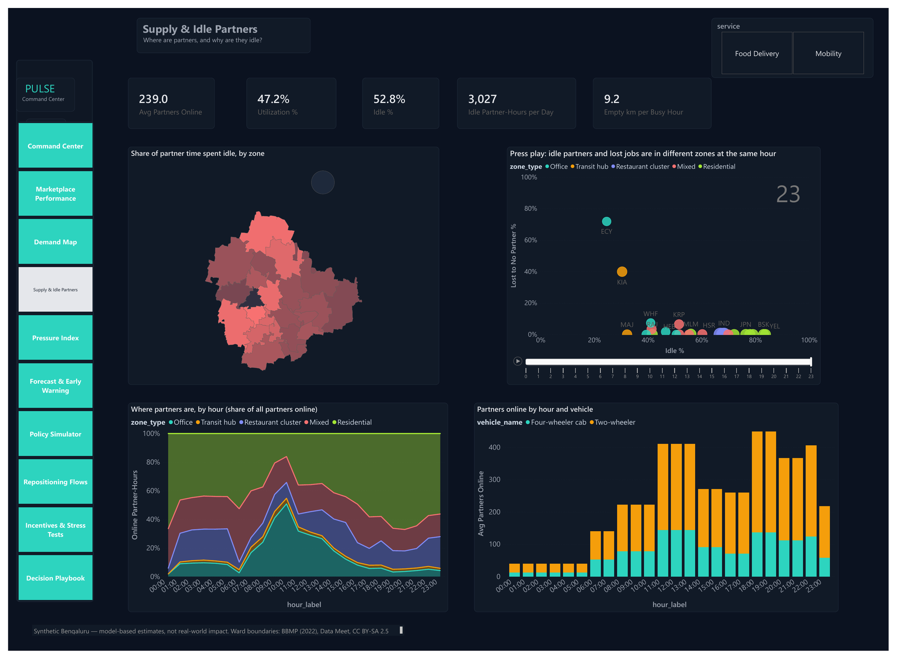 |
| 5 | Pressure Index | 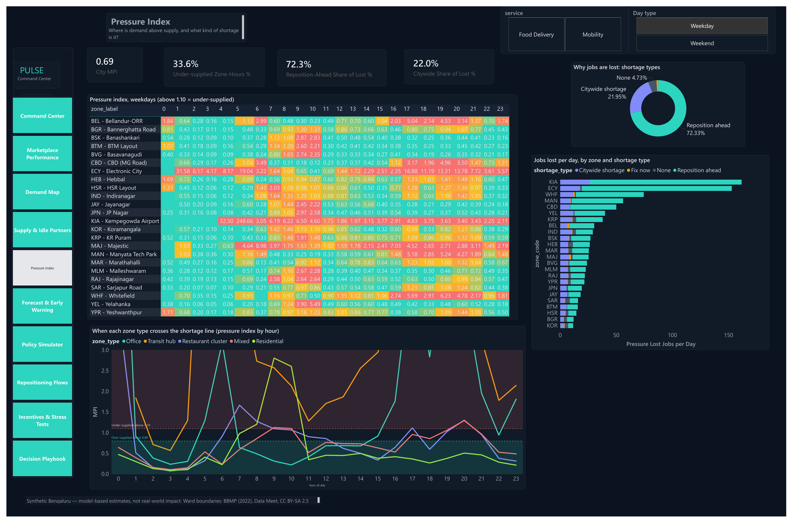 |
| 6 | Forecast & Early Warning | 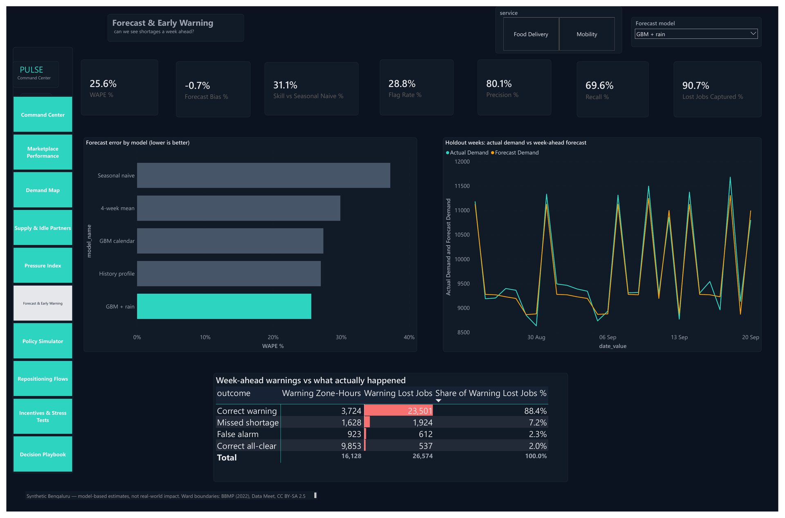 |
| 7 | Policy Simulator | 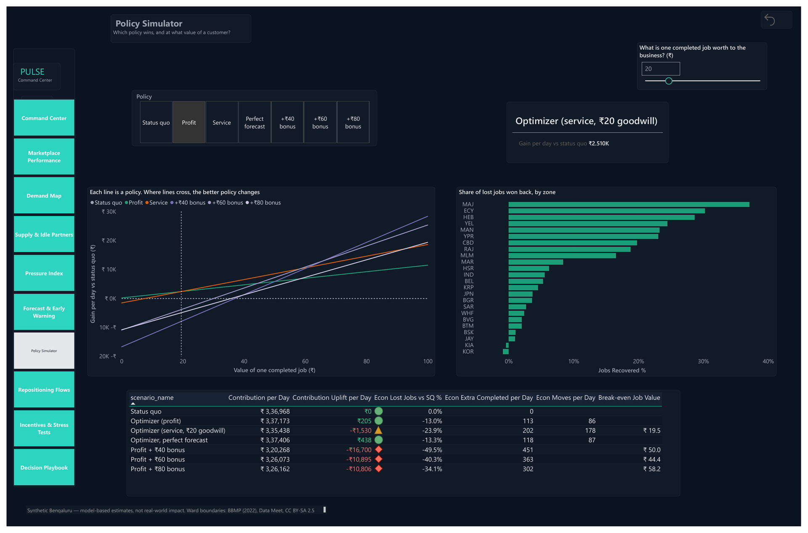 |
| 8 | Repositioning Flows | 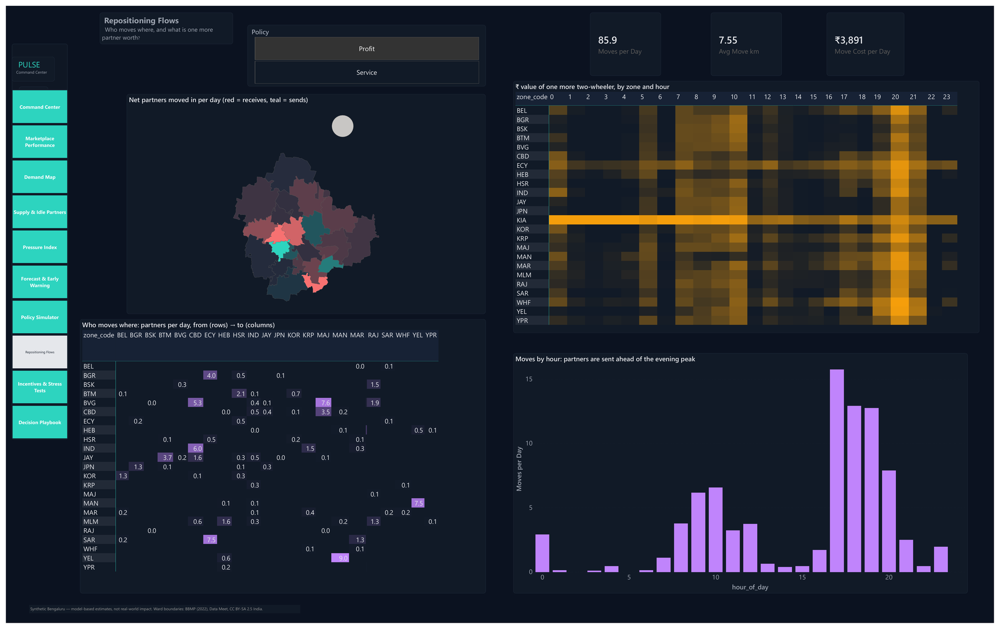 |
| 9 | Incentives & Stress Tests | 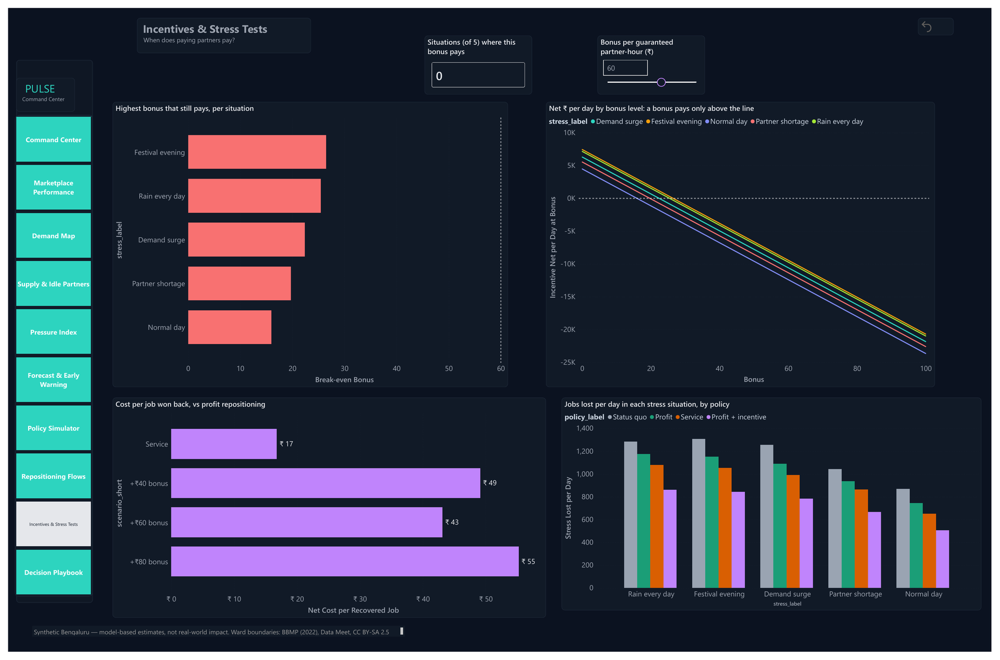 |
| 10 | Decision Playbook | 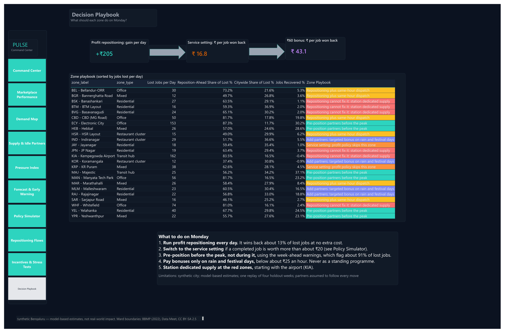 |
| — | Zone Detail (drillthrough) | 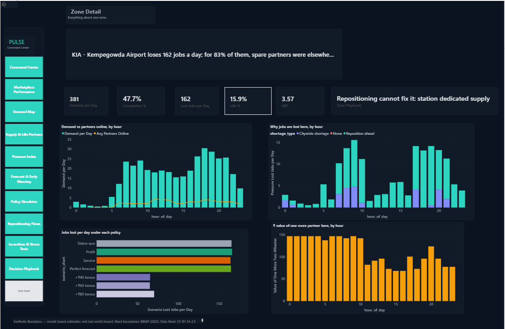 |
| — | Tooltip on hover | 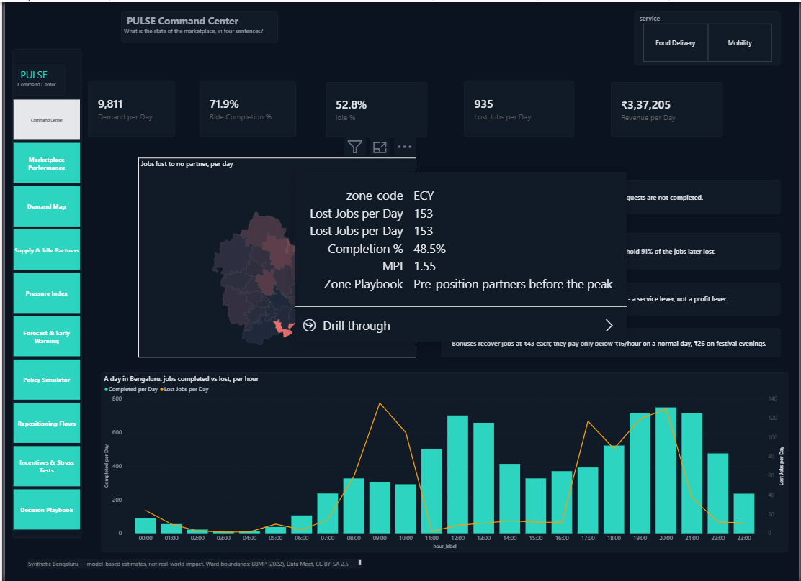 |

## Documents

| Document | Contents |
|---|---|
| `01_Data_Model.md` | The `pbi` views, star schema, relationships, connection steps, model settings |
| `02_DAX_Measures.md` | Every measure (catalogue), 30 checks that prove DAX = SQL, scenario reconciliation |
| `03_Report_Pages.md` | Page-by-page build: layout, visuals, fields, formatting, the story of each page |
| `04_Interactivity.md` | Map, what-if sliders, drillthrough, tooltips, bookmarks, navigation, export |

## Files

| Path | What |
|---|---|
| `sql/00_create_powerbi_views.sql` | Schema `pbi`: 19 views shaped for Power BI |
| `sql/01_dashboard_checks.sql` | The numbers every DAX measure must reproduce |
| `dax/PULSE_measures.dax` | All measures, created in one step from DAX query view, plus their checks |
| `map/bengaluru_zones.json` | The 24 zones for the Shape Map (generated) |
| `theme/PULSE_Command_Center.json` | Dark report theme |
| `PULSE_Command_Center.pbix` | The report (Power BI Desktop; Import mode, about 9 MB). To refresh it, point the SQL Server source at your own `PULSE_DW` |
| `PULSE_Command_Center.pdf` | All 10 pages, for readers without Power BI |
| `images/pages/` | Page screenshots (pages 1–10 rendered from the PDF; Zone Detail drilled to KIA; a tooltip on hover) |

## Build order

```bash
python scripts/report_phase12.py      # views, map file, check tables
```

1. Run `sql/01_dashboard_checks.sql` in SSMS; save Result Set A and B as
   `images/01A_dashboard_checks.png` and `images/01B_scenario_economics.png`.
2. Power BI Desktop: connect and model (`01_Data_Model.md`).
3. Add the measures and run the checks (`02_DAX_Measures.md`, section 6); save
   the DAX result grid as `images/02_dax_checks.png`.
4. Apply the theme and build the pages (`03_Report_Pages.md`, `04_Interactivity.md`).
5. Save the `.pbix`, export the PDF, save page screenshots to `images/pages/`.

## Design choices

- **A semantic layer in SQL, not in Power Query.** Labels, sort orders,
  colours and periods are SQL views, so the warehouse stays the single source
  of truth and the model is reproducible from a script.
- **Facts hold sums, measures make rates.** The same rule as Phase 5, so a
  rate is right at any level of aggregation.
- **Proved, not eyeballed.** Thirty measures are checked against SQL to two
  decimals before any page is built.
- **Decisions, not just charts.** The two what-if sliders turn the Phase 10–11
  results into the questions an executive actually decides: how much is a
  customer worth, and how much should we pay partners.

All numbers are model-based estimates on synthetic data, not real-world impact.
