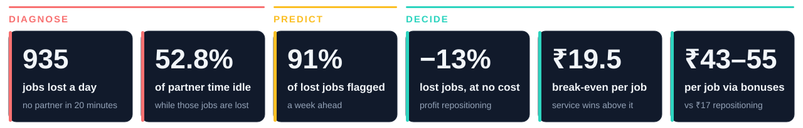
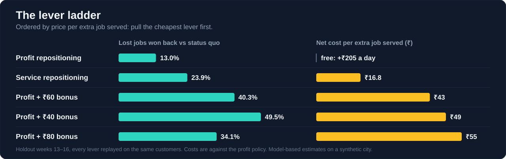
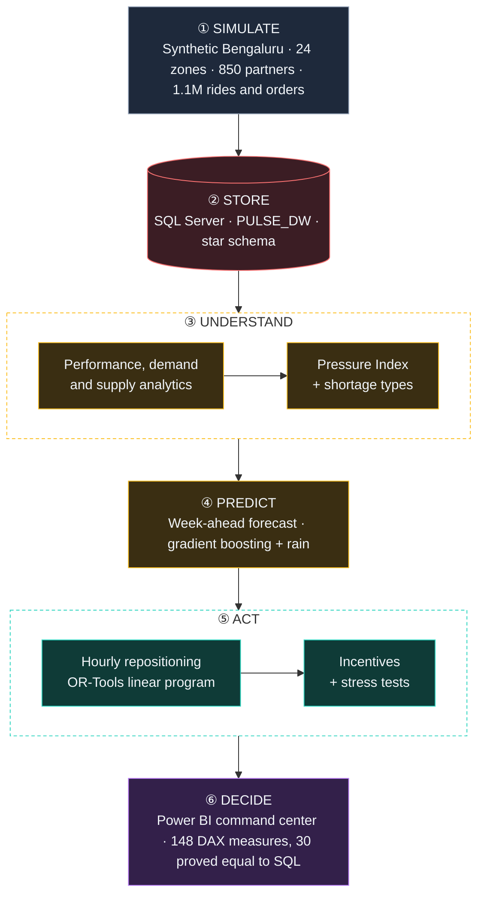

<a id="top"></a>

<picture>
  <source media="(prefers-color-scheme: dark)" srcset="docs/assets/banner-dark.svg">
  <source media="(prefers-color-scheme: light)" srcset="docs/assets/banner-light.svg">
  
</picture>

<div align="center">


<br>


**[The problem](#the-problem)** · **[What PULSE found](#what-pulse-found)** · **[Command center](#the-command-center)** · **[The decision](#the-decision)** · **[How it works](#how-it-works)** · **[12 phases](#twelve-phases-one-question)** · **[Run it](#run-it-yourself)**

</div>

> ### How should a marketplace that runs rides *and* food delivery on one pool of partners anticipate demand and place scarce supply, so customers are served and the business still earns?

PULSE answers that question end to end for a simulated **Bengaluru super-app**: 24 zones, 850 partners, about
**1.1 million rides and food orders** over 16 weeks. It goes from raw events to a SQL Server warehouse, from
analytics to week-ahead forecasts, then to an **OR-Tools optimizer** that moves partners before demand arrives.
It finishes with a **Power BI command center** that turns every result into a decision.

<picture>
  <source media="(prefers-color-scheme: dark)" srcset="docs/assets/kpis-dark.svg">
  <source media="(prefers-color-scheme: light)" srcset="docs/assets/kpis-light.svg">
  
</picture>

---

## The problem

Every evening, customers in Bengaluru's office zones ask for rides and **no partner can reach them in 20 minutes**.
At the same moment, **more than half of all partner time is idle**, a few kilometres away. Partners start where
they live and drift with the jobs they take, so supply ends up following *yesterday's* demand, not the next hour's.

**The marketplace has enough partners. They are in the wrong place at the wrong time.** That is a distribution
problem, not a capacity problem, and it changes which fix is worth paying for.

<sub>📘 Full problem statement, stakeholders and decisions: [`01_Business_Understanding`](01_Business_Understanding)</sub>

---

## What PULSE found

<table>
<tr>
<td width="50%" valign="top">

### 🧭 It is a timing problem
**72%** of lost jobs happen where the neighbourhood is short but **the city has spare partners**. Only 22% need more
partners online. Office zones hold 47% of partners at 09:00 and 3% at 19:00.

<sub>Evidence → [Phase 7](07_Supply_Intelligence) · [Phase 8](08_Supply_Demand_Imbalance)</sub>

</td>
<td width="50%" valign="top">

### 🔮 It can be seen a week ahead
A rain-aware gradient-boosting forecast beats the seasonal benchmark by **31%**. Its warnings flag **29%** of
zone-hours, and those hold **91%** of the jobs later lost.

<sub>Evidence → [Phase 9](09_Forecasting)</sub>

</td>
</tr>
<tr>
<td width="50%" valign="top">

### 🚚 Moving partners is a service lever
Hourly repositioning cuts lost jobs by **13% at no measurable cost** (+0.06% contribution, 95% range spans zero).
A service-first setting cuts them by **24%** for about **₹17 per extra job**.

<sub>Evidence → [Phase 10](10_Optimization)</sub>

</td>
<td width="50%" valign="top">

### 💸 Standing bonuses do not pay
Guaranteed-hour bonuses win back the most jobs but cost **₹43–55 each**. They pay only on rain and festival
days, below about **₹25 per partner-hour**: a surge tool, not a programme.

<sub>Evidence → [Phase 11](11_Incentive_Economics)</sub>

</td>
</tr>
</table>

---

## The command center

<a href="12_PowerBI"></a>

<div align="center">

🗺️ **Real ward-based zone map** · 🎚️ **What-if sliders** for job value and bonus · 🔎 **Right-click any zone** to drill through ·
🧠 **Decomposition tree** · ▶️ **Play axis** through the day · 🎨 **Colours driven by data**

</div>

<details>
<summary><b>Browse all 10 pages and the drillthrough page</b></summary>
<br>

<table>
<tr>
<td width="50%"><br><b>2 · Marketplace Performance</b>: which services, zones and hours fail customers</td>
<td width="50%"><br><b>3 · Demand Map</b>: one map, six metrics, an hour slider</td>
</tr>
<tr>
<td><br><b>4 · Supply & Idle Partners</b>: press play to watch supply drift</td>
<td><br><b>5 · Pressure Index</b>: where demand outruns supply, and why</td>
</tr>
<tr>
<td><br><b>6 · Forecast & Early Warning</b>: shortages seen a week ahead</td>
<td><br><b>7 · Policy Simulator</b>: slide the value of a job, watch the best policy change</td>
</tr>
<tr>
<td><br><b>8 · Repositioning Flows</b>: who moves where, and what a partner is worth</td>
<td><br><b>9 · Incentives & Stress Tests</b>: slide the bonus, see where it pays</td>
</tr>
<tr>
<td><br><b>10 · Decision Playbook</b>: one colour-coded action for every zone</td>
<td><br><b>Zone Detail</b>: everything about one zone, one right-click away</td>
</tr>
</table>

📦 [`PULSE_Command_Center.pbix`](12_PowerBI/PULSE_Command_Center.pbix) · 📄 [PDF of every page](12_PowerBI/PULSE_Command_Center.pdf) · 🛠️ [How it was built](12_PowerBI)

</details>

---

## The decision

<picture>
  <source media="(prefers-color-scheme: dark)" srcset="docs/assets/lever-ladder-dark.svg">
  <source media="(prefers-color-scheme: light)" srcset="docs/assets/lever-ladder-light.svg">
  
</picture>

**What to do on Monday**

1. 🔮 **Forecast shortages a week ahead.** The warning list is short and catches most of the lost demand.
2. 🚚 **Run profit repositioning every day.** It serves more customers at no net cost.
3. ⚖️ **Switch to service-first** if one completed job is worth more than **₹19.5** to the business. That value
   is a business judgement, so the Policy Simulator makes it a slider.
4. 🌧️ **Use bonuses only as a surge tool** on rain and festival days, below the break-even bonus.
5. ✈️ **Station dedicated supply** where repositioning cannot help, starting with the airport (KIA).

---

## How it works



| Layer | What it does | Built with |
|---|---|---|
| **Simulate** | Generates a city with known rules: demand by zone type, hour, weekday, rain and events; partners with home zones and shifts; every job dispatched minute by minute | Python, NumPy, pandas |
| **Store** | 15-table star schema at Zone × Time × Service grain, with quality checks and SQL ↔ Python reconciliation | SQL Server 2025, T-SQL, pyodbc |
| **Understand** | KPI views; demand and supply maps; the **Marketplace Pressure Index** and the lever each shortage needs | T-SQL, GeoPandas, matplotlib |
| **Predict** | Week-ahead demand, supply and shortage forecasts against a seasonal benchmark | scikit-learn |
| **Act** | A linear program moves idle partners each hour; every policy is replayed on the same customers | OR-Tools, SciPy |
| **Decide** | A 10-page report with what-if parameters, drillthrough and a zone playbook | Power BI, DAX |

---

## Twelve phases, one question

| | Phase | Question it answers | What it found |
|:-:|---|---|---|
| 📘 | [**01** Business understanding](01_Business_Understanding) | What is the problem, for whom? | Enough partners overall, in the wrong place at the wrong time |
| 🧩 | [**02** Data ecosystem](02_Data_Ecosystem) | What data does the marketplace produce? | Every decision lives at Zone × Hour × Service |
| 🏙️ | [**03** Synthetic Bengaluru](03_Data_Engineering) | Can a realistic marketplace be simulated? | 1.1M jobs; every planted pattern recovered |
| 🗄️ | [**04** Data warehouse](04_Data_Warehouse) | Can all data live in one trusted place? | 15-table star schema, reconciled with Python |
| 📊 | [**05** Marketplace performance](05_Marketplace_Analytics) | How is the marketplace doing today? | Rides 71.9% completed, food 93.7% |
| 🗺️ | [**06** Demand intelligence](06_Demand_Intelligence) | Where and when is demand? | Commute rides, mealtime food; rain adds 22.8% |
| 🛵 | [**07** Supply intelligence](07_Supply_Intelligence) | Where is supply, and why idle? | Partners idle 52.8%; supply follows the commute |
| 🌡️ | [**08** Supply–demand imbalance](08_Supply_Demand_Imbalance) | What kind of shortage is it? | 72% fixable by moving partners ahead of time |
| 🔮 | [**09** Forecasting](09_Forecasting) | Can shortages be seen coming? | 31% better than benchmark; 91% of losses flagged |
| 🚚 | [**10** Optimization](10_Optimization) | Does moving partners pay? | −13% lost jobs at no cost; a service lever |
| 💸 | [**11** Incentive economics](11_Incentive_Economics) | When does paying partners pay? | Only as a surge tool, below about ₹25 an hour |
| 🖥️ | [**12** Power BI command center](12_PowerBI) | What should an executive do? | 10 interactive pages and a zone playbook |

---

## Why the numbers can be trusted

| | Rule | How PULSE keeps it |
|:-:|---|---|
| ⚖️ | **Fair comparisons** | Every policy, including the status quo, is replayed on exactly the same customers and orders |
| 🔒 | **No tuning on the test** | Settings chosen on weeks 9–12; the holdout weeks 13–16 were simulated once |
| 📏 | **Ranges, not just averages** | Uplifts carry daily 95% ranges; a range spanning zero is reported as no measurable change |
| 🧮 | **One number, one definition** | Each KPI is defined once, computed in SQL, reproduced in Python, and proved in DAX to two decimals |
| 🎯 | **Planted truths recovered** | Patterns built into the city were rediscovered by the analysis without being told |
| 🪞 | **Honest results** | The optimizer gained +9% on a toy model; under realistic economics that became service, not profit, and the project says so |

<sub>All results are model-based estimates on a synthetic city, not measured real-world impact. Every result table is generated by a script, never typed by hand.</sub>

---

## Run it yourself

<details>
<summary><b>Quick start</b></summary>

```bash
pip install -r requirements-lock.txt   # exact tested versions (or requirements.txt)
pip install -e .
pytest                                 # 117 tests

python scripts/run_toy.py              # the optimizer on a 5-zone toy
python scripts/build_all.py            # build synthetic Bengaluru (~2–4 min)
python scripts/load_warehouse.py       # load SQL Server warehouse PULSE_DW
python scripts/report_phase5.py        # ... then report_phase6 to report_phase12, in order
```

Phases 4–12 need SQL Server (connection in `config/warehouse.yaml`). Tested on Python 3.14.
Every script is described in [`scripts/README.md`](scripts/README.md).

</details>

<details>
<summary><b>Reproduce every result</b></summary>
<br>

| Document | What it shows | Regenerate |
|----------|---------------|------------|
| `10_Optimization/Validation_Results.md` | Optimizer proof on a 5-zone toy: hand calculation, stress tests, +9% vs naive dispatch, bottleneck pricing | `python scripts/report_optimizer.py` |
| `03_Data_Engineering/Generation_Results.md` | Synthetic Bengaluru: planted patterns recovered, status-quo performance, the supply mismatch | `python scripts/report_generation.py` |
| `04_Data_Warehouse/Load_Results.md` | Warehouse: tables loaded, quality checks, SQL ↔ Python reconciliation | `python scripts/report_warehouse.py` |
| `05_Marketplace_Analytics/01_…05_*.md` | Baseline KPIs: overview, mobility, food, supply, economics | `python scripts/report_phase5.py` |
| `06_Demand_Intelligence/01_…05_*.md` | Demand map, zone profiles, hourly patterns, pressure points, restaurants, rain | `python scripts/report_phase6.py` |
| `07_Supply_Intelligence/01_…05_*.md` | Supply map, partner time states, idle supply vs reach, empty km, eligibility | `python scripts/report_phase7.py` |
| `08_Supply_Demand_Imbalance/01_…05_*.md` | Pressure Index (validated), pressure map, shortage types, service and rain pressure | `python scripts/report_phase8.py` |
| `09_Forecasting/01_…04_*.md` | Forecast approach, demand and supply accuracy, week-ahead shortage prediction | `python scripts/report_phase9.py` |
| `10_Optimization/01_…05_*.md` | City optimizer, policy comparison with 95% ranges, where gains come from, value of supply | `python scripts/tune_policy.py`, then `python scripts/report_phase10.py` |
| `11_Incentive_Economics/01_…03_*.md` | Incentive design, whether incentives pay, the lever ladder, stress scenarios | `python scripts/report_phase11.py` |
| `12_PowerBI/01_…02_*.md` | Power BI model, measure catalogue, 30 DAX-vs-SQL checks | `python scripts/report_phase12.py` |
| `docs/assets/*.svg` | The graphics on this page | `python scripts/build_readme_assets.py` |

</details>

<details>
<summary><b>Repository map</b></summary>

```text
PULSE
├── 01_Business_Understanding     problem, operating model, glossary, assumptions, KPI dictionary
├── 02_Data_Ecosystem             entities, events, lineage
├── 03_Data_Engineering           how synthetic Bengaluru is generated, and the checks
├── 04_Data_Warehouse             PULSE_DW star schema, loader SQL, quality checks
├── 05_ … 11_                     one folder per analysis phase: SQL, findings, charts
├── 12_PowerBI                    report (.pbix), PDF, semantic layer, DAX, page guide
├── src/pulse                     reusable Python: generation, warehouse, forecasting, optimization, geo
├── config                        every parameter (config/bengaluru for the city)
├── scripts                       entry points, one per step
├── tests                         117 validation and stress tests
└── docs                          front-page graphics
```

Reference: [Assumptions](01_Business_Understanding/Assumptions.md) · [KPI dictionary](01_Business_Understanding/KPI_Dictionary.md) · [Glossary](01_Business_Understanding/03_Glossary.md) · [Data generation](03_Data_Engineering/Data_Generation_Framework.md)

</details>

---

<div align="center">

**Built by [Anto Abraham A J](https://github.com/ANTO-ABRAHAM-AJ)**

<sub>Ward boundaries: BBMP (2022) via DataMeet Municipal Spatial Data, CC BY-SA 2.5 India ·
City, partners and customers are synthetic · Results are model-based estimates</sub>

<sub>[Back to top ↑](#top)</sub>

</div>
